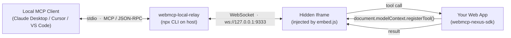

<div align="center">

# WebMCP Nexus

**A non-invasive frontend integration kit for the [WebMCP](https://webmcp.org) standard.**

Turn any React application into a target MCP clients can drive directly — in minutes.

[简体中文](./README.md) | **English**

[](https://www.npmjs.com/package/webmcp-nexus-sdk)
[](https://www.npmjs.com/package/vite-plugin-webmcp-nexus)
[](https://www.npmjs.com/package/webpack-plugin-webmcp-nexus)
[](./LICENSE)
[](#status)

[**🚀 Try the Live Demo →**](https://alibaba.github.io/webmcp-nexus/)

</div>

---

## Table of Contents

- [What is WebMCP Nexus](#what-is-webmcp-nexus)
- [Why WebMCP Nexus](#why-webmcp-nexus)
- [Highlights](#highlights)
- [Project Structure](#project-structure)
- [Quick Start](#quick-start)
- [Three-Tier Registration](#three-tier-registration)
- [Live Demo](#live-demo)
- [Driving Web Apps from Local Agents](#driving-web-apps-from-local-agents)
- [AI Coding Skill](#ai-coding-skill)
- [Browser Compatibility](#browser-compatibility)
- [Tool Name Collisions](#tool-name-collisions)
- [Supported TypeScript Types](#supported-typescript-types)
- [Tech Stack](#tech-stack)
- [Scripts](#scripts)
- [Status](#status)
- [Contributing](#contributing)
- [License](#license)

## What is WebMCP Nexus

[WebMCP](https://webmcp.org) is a W3C browser-standard proposal — jointly championed by Google and Microsoft — that lets a web page expose its own capabilities as MCP (Model Context Protocol) tools via `document.modelContext.registerTool()`. **WebMCP Nexus** is a production-ready frontend toolkit built around that standard:

- **Runtime SDK** — exposes only two APIs (`registerGlobalTools` / `useWebMcpTools`) that together cover global, route, and component lifecycles.
- **Build plugins** — first-class support for both Vite and Webpack. At build time, TypeScript types and JSDoc are statically analysed and compiled into JSON Schema; tool functions need no annotations or wrappers.
- **Polyfill integration** — modern browsers use the native API; everywhere else, the SDK entry point lazily loads the bundled polyfill, with zero impact on application code.
- **Agent Skill** — a built-in Skill for coding agents such as Claude Code and Cursor, reducing "generate a tool from this function" to a single natural-language instruction.

> In one sentence: write an ordinary TypeScript function, add a single JSDoc comment, and it becomes callable by any MCP client.

## Why WebMCP Nexus

| Dimension          | Common practice                                       | WebMCP Nexus                                                                                              |
| ------------------ | ----------------------------------------------------- | --------------------------------------------------------------------------------------------------------- |
| API surface        | Decorators, wrapper functions, explicit schema config | **Two APIs** cover every case                                                                             |
| Type contract      | Hand-written JSON Schema kept in sync with TS types   | Schema **inferred from TS types at build time** via `ts-morph` — a single source of truth                 |
| Function intrusion | `defineApi` / `createTool` wrappers                   | **Non-invasive** — the function stays exactly as it was; existing call sites are untouched                |
| Lifecycle          | Global registration only, manually managed            | **Three-tier scoping** (global / route / component) with automatic deregistration on unmount              |
| Browser support    | Each call site handles availability checks            | SDK ships with a **lazily loaded polyfill** covering Chrome, Firefox, and Safari                          |
| Desktop bridging   | Roll your own stdio / WebSocket bridge                | Plug-and-play with [`@mcp-b/webmcp-local-relay`](https://www.npmjs.com/package/@mcp-b/webmcp-local-relay) |

## Highlights

- 🪶 **Minimal API** — `registerGlobalTools` + `useWebMcpTools`: graspable in 30 seconds, integrated in five minutes.
- 🔬 **Build-time type inference** — `ts-morph`-powered static analysis. Function signature = JSON Schema. Zero runtime overhead.
- 🔁 **HMR-friendly** — change a tool signature during development and its schema re-registers automatically; no manual reload.
- 🧩 **Three-tier scoping** — component-level tools follow the React lifecycle, keeping "ghost tools" out of the agent's context.
- 🛡️ **Collision-aware** — an internal scope ownership registry warns on duplicate names without aborting, and isolates teardown strictly per scope.
- 🌐 **Transparent cross-browser compatibility** — Chrome 149+ uses the native `document.modelContext` (146–149 are entry-bridged by the polyfill); everywhere else, `@mcp-b/webmcp-polyfill@5.1.0` is activated automatically.
- 🤝 **First-class desktop agents** — via `@mcp-b/webmcp-local-relay`, local MCP clients like Claude Desktop, Cursor, and VS Code can drive your web app directly.
- 🧠 **Bundled AI coding Skill** — "convert this function into a WebMCP tool" becomes a single instruction for your coding agent.

## Project Structure

```
webmcp-nexus/
├── apps/
│   └── demo/                        # Reference app (Vite + Webpack dual build)
├── packages/
│   ├── webmcp-core/                 # Build-time core: TS type extraction + JSON Schema generation
│   ├── webmcp-sdk/                  # Runtime SDK (2 APIs + polyfill bootstrap)
│   ├── vite-plugin-webmcp/          # Vite plugin
│   └── webpack-plugin-webmcp/       # Webpack plugin
└── skill/
    └── SKILL.md                     # Onboarding Skill for AI coding agents
```

Packages published to the public npm registry:

| Package                                                                                    | Purpose                             |
| ------------------------------------------------------------------------------------------ | ----------------------------------- |
| [`webmcp-nexus-sdk`](https://www.npmjs.com/package/webmcp-nexus-sdk)                       | Runtime SDK                         |
| [`webmcp-nexus-core`](https://www.npmjs.com/package/webmcp-nexus-core)                     | Type extraction + Schema generation |
| [`vite-plugin-webmcp-nexus`](https://www.npmjs.com/package/vite-plugin-webmcp-nexus)       | Vite build plugin                   |
| [`webpack-plugin-webmcp-nexus`](https://www.npmjs.com/package/webpack-plugin-webmcp-nexus) | Webpack build plugin                |

## Quick Start

> Prerequisites: Node.js 18+. pnpm is recommended.

### 1. Install

```bash
pnpm add webmcp-nexus-sdk
pnpm add -D vite-plugin-webmcp-nexus     # or webpack-plugin-webmcp-nexus
```

### 2. Configure the build plugin

**Vite**

```ts
// vite.config.ts
import { defineConfig } from 'vite';
import react from '@vitejs/plugin-react';
import { vitePluginWebMcp } from 'vite-plugin-webmcp-nexus';

export default defineConfig({
  plugins: [react(), vitePluginWebMcp({ include: ['src/**/*.ts', 'src/**/*.tsx'] })],
});
```

**Webpack**

```ts
// webpack.config.ts
import { WebMcpPlugin } from 'webpack-plugin-webmcp-nexus';
import type { Configuration } from 'webpack';

const config: Configuration = {
  // ... entry / module / resolve / etc.
  plugins: [new WebMcpPlugin({ include: ['src'] })],
};

export default config;
```

Full dual-build examples live in [apps/demo/vite.config.ts](apps/demo/vite.config.ts) and [apps/demo/webpack.config.ts](apps/demo/webpack.config.ts).

### 3. Write an ordinary TS function

```ts
// src/tools/queries.ts
/**
 * Search tasks by keyword.
 * @readonly
 */
export async function searchTasks(params: {
  /** Search keyword */
  query: string;
  /** Maximum number of results (default 50) */
  limit?: number;
}): Promise<{ count: number; tasks: Task[] }> {
  // ... your original implementation — no wrapping required
}
```

### 4. Register

```ts
// src/main.tsx
import { registerGlobalTools } from 'webmcp-nexus-sdk';
import * as queries from './tools/queries';

registerGlobalTools(queries);
```

The build plugin derives a JSON Schema from `searchTasks`'s TS types and JSDoc and attaches it to the function as `__webmcpSchema`; the SDK reads that field at runtime and registers the tool against `document.modelContext`.

## Three-Tier Registration

| Tier      | API                     | Lifecycle                                  | Use case                                     |
| --------- | ----------------------- | ------------------------------------------ | -------------------------------------------- |
| Global    | `registerGlobalTools()` | Registered at app boot, never deregistered | Cross-cutting APIs (queries, auth, CRUD)     |
| Route     | `useWebMcpTools()`      | Page mount / unmount                       | Operations specific to the current route     |
| Component | `useWebMcpTools()`      | Component mount / unmount                  | Modals, panels, and other local interactions |

**Route / component-level registration example:**

```tsx
import { useWebMcpTools } from 'webmcp-nexus-sdk';

export default function TasksPage() {
  const { createTask, updateTask, deleteTask } = useTodoStore();

  useWebMcpTools({ createTask, updateTask, deleteTask });

  return /* … */;
}
```

Tools owned by the same scope are deregistered from `modelContext` on unmount, so **agents cannot call the wrong tool on the wrong page**.

## Live Demo

[`apps/demo`](apps/demo) is a complete Todo / project-management app that exercises every integration pattern: global query tools, component-level form tools, route-navigation tools, an HMR-aware debug panel, and more.

> 🌐 **Hosted preview**: <https://alibaba.github.io/webmcp-nexus/> (auto-deployed from `main` via GitHub Pages).

```bash
pnpm install
pnpm dev               # Vite demo at http://localhost:5173
pnpm dev:webpack       # Webpack demo at http://localhost:3001
```

Press <kbd>⌘</kbd> + <kbd>\\</kbd> in the running app to toggle the built-in **Debug Panel**, which lists every registered tool along with its parameter schema and last invocation result.

Key files to read:

- Global tool registration entry: [apps/demo/src/main.tsx](apps/demo/src/main.tsx)
- Global query tools: [apps/demo/src/tools/queries.ts](apps/demo/src/tools/queries.ts)
- Route navigation tool: [apps/demo/src/tools/navigation.ts](apps/demo/src/tools/navigation.ts)
- Page-level registration: [apps/demo/src/pages/TasksPage.tsx](apps/demo/src/pages/TasksPage.tsx)

## Driving Web Apps from Local Agents

With the official [`@mcp-b/webmcp-local-relay`](https://www.npmjs.com/package/@mcp-b/webmcp-local-relay), local MCP clients such as Claude Desktop, Cursor, and VS Code can **drive a web application running in your browser directly** — your app becomes the agent's hands.

### How it works



- `webmcp-local-relay` runs locally as an **stdio MCP server**, spawned by the desktop agent.
- It exposes a WebSocket endpoint on `localhost:9333`.
- The web app loads the relay's `embed.js`, which injects a hidden iframe; the iframe opens the WebSocket to the relay and continuously reports the tools registered on `document.modelContext` to the desktop agent.

### Integration steps

> **Prerequisites**: the relay CLI requires **Node 22+** (`npx -y @mcp-b/webmcp-local-relay@latest` fails outright on Node 20); the page side needs `@mcp-b/webmcp-polyfill` 5.x (declared as a `dependencies` entry of this SDK and resolved by your bundler — **not inlined into the published output**) or native Chrome 149+.

**1. Add the `embed.js` from `@mcp-b/webmcp-local-relay` to your page**

Add a single line to the app's entry HTML (e.g. [apps/demo/index.html](apps/demo/index.html)):

```html
<!-- index.html -->
<script src="https://cdn.jsdelivr.net/npm/@mcp-b/webmcp-local-relay@latest/dist/browser/embed.js"></script>
```

The script injects a hidden blob iframe, reads `document.modelContext`, discovers tools via `getTools()` and invokes them via `executeTool()` (re-fetching the descriptor before every call so Chrome never receives a stale object), then opens the WebSocket bridge to the local relay. **No changes to your application code or SDK usage are required.**

Three hard constraints:

- **Follow `@latest`, and keep the page side and the local relay server on the same strategy**: nexus only controls the embed's version — the relay **server** version lives in each user's own MCP client config. Pinning any fixed version makes the page side the only fixed end of a mismatch, and an `@5` embed against an `@latest` (6.0.0) server makes every tool invocation fail. The SDK's two-axis normalization layer (see "Browser compatibility") absorbs the input-shape and schema-shape differences between embed 5.x and 6.x, but **keeping the embed and the local relay server on the same major is the consumer's responsibility**.
- **It must be a classic synchronous `<script>`**: `embed.js` reads its `data-*` attributes through `document.currentScript`. Adding `type="module"` / `defer` / `async` makes **every attribute silently fall back to its default**.
- **Self-hosting requires `widget.html` in the same directory**: `embed.js` fetches it and builds a blob iframe. **If that fetch fails the relay fails closed** (a single `console.error`, and no tools are reported at all). Cross-origin hosting must allow CORS. If you use a regional mirror, mirror the whole `dist/browser/` directory rather than a single file.

The full set of `data-*` attributes (`embed.js` 6.0.0):

| Attribute              | Default     | Purpose                                                                                                                          |
| ---------------------- | ----------- | -------------------------------------------------------------------------------------------------------------------------------- |
| `data-relay-host`      | `127.0.0.1` | Relay listen address                                                                                                             |
| `data-relay-port`      | `9333`      | Preferred port. Discovery actually probes **9333–9348** and persists the choice to `~/.webmcp/relay-port.json`                   |
| `data-request-timeout` | `60000`     | Per-invocation timeout (ms). Must be **paired** with the CLI's `--invoke-timeout` (default 65000) — keep the CLI slightly larger |
| `data-relay-id`        | —           | Filter by relay ID when several relays coexist                                                                                   |
| `data-relay-workspace` | —           | Filter by workspace when several relays coexist                                                                                  |
| `data-auto-connect`    | `true`      | Set `"false"` to defer discovery until a `webmcp.connect` message arrives                                                        |
| `data-debug`           | off         | Enables `[webmcp-relay-embed]` diagnostic logging. **Always turn this on when debugging**                                        |

> **CSP requirements**: `frame-src blob:`, `script-src blob:` (the blob iframe inlines a config script), `connect-src ws://127.0.0.1:9333-9348`. Sites with a restrictive CSP will fail silently.

**2. Install the relay in your MCP client**

**Preferred: one-click MCPB bundle.** Download the `.mcpb` file from [GitHub Releases](https://github.com/WebMCP-org/npm-packages/releases) and double-click to install — zero configuration, no terminal, and it starts with loopback + automatic port discovery + all page origins allowed.

**Alternative: JSON config.** For Claude Desktop, edit `claude_desktop_config.json`:

```json
{
  "mcpServers": {
    "webmcp-local-relay": {
      "command": "npx",
      "args": ["-y", "@mcp-b/webmcp-local-relay@latest"]
    }
  }
}
```

Cursor and VS Code use the same configuration block; only the file location differs. You can also run the CLI directly: `npx @mcp-b/webmcp-local-relay`.

**3. Start the web app and drive it from the agent**

```bash
pnpm dev      # any app that uses webmcp-nexus-sdk works
```

Restart Claude Desktop or Cursor, and a new session will surface the tools coming from your browser. For the bundled demo, try:

> "Show every task in the 'todo' state, sorted by due date ascending, then mark the first one as done."

The agent will call `listTasks` → `setTaskSort` → `setTaskStatus` in sequence, and you will see each step play out in the browser.

### What you will see in the MCP client

**Three static management tools** (provided by the relay, listed alongside yours):

| Tool                  | Purpose                                                                             |
| --------------------- | ----------------------------------------------------------------------------------- |
| `webmcp_list_sources` | Lists connected browser tabs and their metadata                                     |
| `webmcp_list_tools`   | Lists every relayed tool with its source. **Call this first when debugging**        |
| `webmcp_open_page`    | Opens a URL, or in server mode refreshes a connected source page by matching origin |

**Tool names get rewritten by the relay** — this is not a bug:

- `sanitizeName` replaces every `[^a-zA-Z0-9_]` with `_`. The WebMCP protocol allows `.` and `-` in tool names, but the MCP client will see `get_canvas_info` rather than `get-canvas-info`. **So please use camelCase tool names only** (see [`skill/SKILL.md`](skill/SKILL.md)).
- When several tabs publish the same tool name, all of them get a `_<4-char tabId>` suffix (e.g. `search_ed93`, `search_a1b2`), with deterministic `_2`/`_3` on further collisions. **Close the extra tabs to remove the suffix.**
- Names are truncated to 128 characters.

For troubleshooting, prefer the [relay's own Troubleshooting table](https://www.npmjs.com/package/@mcp-b/webmcp-local-relay#troubleshooting) (not duplicated here, so the two cannot drift apart). One nexus-specific tip: if the MCP client sees no tools, first open the demo's DebugPanel (`Cmd/Ctrl + \`) to confirm the tools registered in-page, then add `data-debug` to `embed.js` and read the `[webmcp-relay-embed]` logs.

## AI Coding Skill

[`skill/SKILL.md`](skill/SKILL.md) is a Skill document purpose-built for AI coding agents. It covers:

- Hard constraints on tool-function signatures, JSDoc, and TS types (graded MUST / SHOULD / MAY);
- A **zero-risk refactor workflow** for turning existing functions into WebMCP tools: only signatures and comments change — business logic is never touched;
- Onboarding guidance for the SDK and the Vite / Webpack build plugins;
- Worked examples paired with anti-patterns.

### Installation

<details>
<summary><strong>Claude Code</strong></summary>

```bash
# Project-scoped (current repo only)
mkdir -p .claude/skills
cp skill/SKILL.md .claude/skills/webmcp-nexus.md

# User-scoped (all projects)
mkdir -p ~/.claude/skills
cp skill/SKILL.md ~/.claude/skills/webmcp-nexus.md
```

</details>

<details>
<summary><strong>Cursor</strong></summary>

```bash
mkdir -p .cursor/rules
cp skill/SKILL.md .cursor/rules/webmcp-nexus.mdc
```

Alternatively, paste the contents of `skill/SKILL.md` into Settings → Rules.

</details>

<details>
<summary><strong>Other AI IDEs (Qoder, Windsurf, etc.)</strong></summary>

Import `skill/SKILL.md` as a Rule / Context document in your IDE's AI settings. Trigger phrases live in the frontmatter `description` field, so any modern agent framework will load the Skill on demand.

</details>

### Usage example

> "Turn `createTask` in `apps/demo/src/store/TodoStore.tsx` into a WebMCP tool and register it on the tasks page."

The agent follows the workflow defined in the Skill: it fills in missing JSDoc, reshapes the parameters into the required object form, and adds the `useWebMcpTools` call at the right mount point — **without touching any business logic**.

## Browser Compatibility

The WebMCP draft moved the `modelContext` getter from `Navigator` to `Document` on 2026-05-27 ([webmcp#173](https://github.com/webmachinelearning/webmcp/issues/173) / [#184](https://github.com/webmachinelearning/webmcp/pull/184)), and Chrome 150 deprecated `navigator.modelContext`. The SDK is **document-first with a navigator fallback** throughout, transparently to your code.

| Environment                                  | Behaviour                                                                                                                                                                                                                                                                                                                                                                                                                   |
| -------------------------------------------- | --------------------------------------------------------------------------------------------------------------------------------------------------------------------------------------------------------------------------------------------------------------------------------------------------------------------------------------------------------------------------------------------------------------------------- |
| Chrome 155+                                  | Native `document.modelContext` is the canonical entry. `executeTool` now takes an **object** as its second argument (passing a string throws `TypeError: … invalid input object: value is not an object`), same-document `inputSchema` from `getTools()` is now an **object**, and `navigator.modelContextTesting` is gone                                                                                                  |
| Chrome 150–154 (Origin Trial / flag)         | Native `document.modelContext` is the canonical entry; `navigator.modelContext` is a deprecated alias (one-time warning on first access). `executeTool` still takes a **JSON string** and same-document `inputSchema` still returns the **serialized string**                                                                                                                                                               |
| Chrome 149                                   | First Origin Trial release; still `navigator.modelContext`, and `@mcp-b/webmcp-polyfill@5.1.0` performs **entry bridging** (the same instance is exposed on document — the native implementation is neither replaced nor wrapped)                                                                                                                                                                                           |
| Chrome 146–148                               | Flag-only. 146–147 have `unregisterTool` (nexus uses the L2 unregister fallback); it was removed in 148 in favour of `AbortSignal`. nexus keeps the full compatibility layer on this tier (EventTarget backfill, `listTools`/`callTool` synthesis, `toolchange` bridging) and **additionally synthesizes `getTools`/`executeTool` from `modelContextTesting`**, so the relay can discover and invoke tools on this tier too |
| Chrome <146 / Firefox / Safari / legacy Edge | [`@mcp-b/webmcp-polyfill@5.1.0`](https://www.npmjs.com/package/@mcp-b/webmcp-polyfill) is installed automatically on first registration; `document.modelContext` is the canonical entry, transparently to the app                                                                                                                                                                                                           |

> **nexus does modify the host object on native tiers.** To absorb Chrome 155's input-shape change and relay 6.x's schema guard, the SDK installs **non-enumerable** shape-normalization wrappers on `getTools` / `executeTool` — `Object.keys(document.modelContext)` is still `[]`, so the polyfill's "ModelContext instance has no own enumerable keys" WebIDL fidelity invariant holds. Known deviation: on the polyfill tier `for...in` no longer yields those two methods (`Object.keys`, spread and `instanceof` are unaffected). `registerTool` is never wrapped and its arity stays 1.

> **Two-axis shape normalization.** Chrome 155 changed the native `executeTool` second argument from a JSON string to an object; relay 6.x followed by sending an object **and dropped its tolerance for string `inputSchema`** — tools with a string schema are discarded at the **discovery** stage (a single `console.warn` of "input schema is malformed"), so the agent sees zero tools, which is more insidious than an execution failure. The SDK therefore normalizes on two axes: **axis 1** converts the `executeTool` argument to whatever the host expects, and **axis 2** converts string `inputSchema` to an object per tool (upstream `webmcp-types` explicitly requires that "Consumers that support both generations must branch on `typeof`").
>
> Effect and limits: **on the nexus side, embed 5.x and 6.x can both discover and invoke tools**, and application code may pass either an object or a string without knowing the host generation. Chrome 155+ and the polyfill-owned tier are measured; **the Chrome 149–154 tier is inferred from the upstream type declarations and not verified on a real browser here**. nexus also cannot control whether the embed and the local relay **server** are on the same major (the server version lives in each user's own MCP client config) — keep both sides on `@latest`, and re-verify if relay 7.x introduces a new shape axis. relay 2.x works only on the polyfill-owned and 146–148 tiers; do not use it for new integrations.

> **The shape of `inputSchema` is not cleanly tiered by browser version.** The polyfill returns a JSON Schema **object** when it owns the context; Chrome 149–153 (most of the Origin Trial population) and 154's **same-document tools return the serialized string**; the [webmcp#241](https://github.com/webmachinelearning/webmcp/issues/241) object shape rolled out from Chrome 154.0.8013 for cross-document tools first, and **from Chrome 155 same-document tools return objects too** (measured 20/20) — and every tool nexus registers is same-document. The upstream type is therefore `InputSchema | string`. The SDK handles all three shapes (**string / object / missing key**) and always feature-detects, never version-sniffs.

### Host admission requirements

Both polyfill 5.x and native Chrome run a full set of admission checks at the entry of `registerTool` / `getTools` / `executeTool` (2.x did not). When they fail, the tool **is not registered**, and the SDK reports a diagnosable message based on `error.name`:

| Prerequisite                                                                                                            | On failure                                                                              |
| ----------------------------------------------------------------------------------------------------------------------- | --------------------------------------------------------------------------------------- |
| Must be a secure context                                                                                                | The polyfill does not install at all                                                    |
| Must be an **origin-isolated** document: `Origin-Agent-Cluster: ?0` or `document.domain` disables the entire WebMCP API | `SecurityError`                                                                         |
| Permissions Policy `tools` (defaults to `self`): cross-origin iframes need `allow="tools"`                              | `NotAllowedError`                                                                       |
| The document must be fully active (registrations during navigation are ignored)                                         | `InvalidStateError` (silent)                                                            |
| Tool name matches `^[A-Za-z0-9_.-]{1,128}$`, `description` is non-empty                                                 | `InvalidStateError`. Both the SDK and the build plugin fall back / shift the check left |
| Cross-document exposure (`exposedTo` / `fromOrigins`) requires native WebMCP                                            | `NotSupportedError` (unsupported by the polyfill)                                       |

A failed registration **never blocks UI rendering**, and the failed tool never appears in the widget push (ghost-tool protection).

## Migrating to 1.0.0

See [CHANGELOG.md](./CHANGELOG.md) for the full list. Highlights:

- **The public SDK API is additive only**: the signatures and behaviour of `registerGlobalTools` / `useWebMcpTools` / `withWebMcpTools` are unchanged. Neither your application code nor your build-plugin config needs editing.
- The host surface moved from `navigator.modelContext` to `document.modelContext` (done inside the SDK; invisible to you).
- `unregisterTool` was removed from the protocol → teardown now goes through the `AbortSignal` passed to `registerTool(tool, { signal })` (done inside the SDK).
- `registerTool` is now asynchronous, and a failure no longer blocks the UI.
- **Tool functions may declare a second parameter to receive the execution-cancellation signal**: `async (params, { signal }) => {...}`. Existing single-parameter tools need no change.
- **Three new JSDoc tags**: `@title <text>`, `@untrusted`, `@consequential` — structurally identical to the existing `@readonly`. `__webmcpSchema` grows from three fields to six.
- **New build-time validation**: an invalid tool name now fails `pnpm build` outright instead of silently emitting a tool that can never register.
- The relay's `embed.js` follows `@latest` (see the integration steps above), and must be on the same strategy as the local relay server.

## Relationship with other `@mcp-b/` packages

- **`@mcp-b/global` must not be loaded alongside this SDK.** It initializes on import and **replaces** both the `document` and `navigator` surfaces with a `BrowserMcpServer` using value descriptors, which destroys nexus's legacy-host compatibility layer. Pick one.
- **`@mcp-b/webmcp-local-relay`** reads only `document.modelContext` and requires only `getTools()` + `executeTool()`. **relay 2.x works only in browsers where the polyfill owns the context (Chrome <146 / Firefox / Safari)** — because the `navigator.modelContextTesting` provided by `installTestingShim` is installed only in that path; on native Chrome the polyfill returns early. Use relay 5.x/6.x for new integrations. The relay's "Runtime Compatibility" section lists three supported page runtimes (`@mcp-b/global` / "current native Chrome with **object-input** `executeTool()`", i.e. Chrome 155+ / `@mcp-b/webmcp-polyfill`), and the upstream docs additionally advise loading the embed from the same major version as the page's runtime. nexus keeps its polyfill at 5.1.0, which is outside that advice; the difference is absorbed by the SDK's **two-axis shape-normalization layer** (see "Browser compatibility") — a **deliberate deviation**, not something the upstream support matrix covers.
- **`usewebmcp` / `react-webmcp` / `webmcp-ts-sdk`** are the upstream equivalents, positioned differently: nexus's differentiating value is **build-time schema derivation from TS types + JSDoc**, **three-tier scoping**, and the **scope ownership registry** — none of which exist upstream. nexus does not depend on them.
- **Declarative forms**: polyfill 5.1.0 automatically installs declarative form support (`<form toolname tooldescription toolautosubmit toolparamdescription>`, `SubmitEvent.agentInvoked` / `respondWith()`). Those tools are registered directly into the host by the polyfill and **do not pass through nexus's ownership mirror**, so they appear in `document.modelContext.getTools()` and in the demo's DebugPanel, but not in nexus's widget push. The `toolactivated` / `toolcancel` events on `window` and the CSS `:tool-form-active` / `:tool-submit-active` pseudo-classes are **native-Chrome only**; the polyfill does not emulate them.
- To support declarative forms, polyfill 5.1.0 rewrites `Element.prototype.attachShadow` and `HTMLFormElement.prototype.submit`. Projects using shadow DOM or custom form-submit logic should evaluate the impact.
- **`@mcp-b/webmcp-types@5.1.0`** is added as a type dependency (`import type`; it does not reach the browser bundle) and provides the global declarations for `Document.modelContext` / `Navigator.modelContext` / `SubmitEvent.agentInvoked` (all optional as of 5.1.0).

## Tool Name Collisions

The SDK maintains an internal scope-ownership registry that tracks the origin (scope + scopeId) of every tool name:

- When multiple scopes register the same tool name, the SDK **logs a warning but still completes the registration** — UI rendering is never blocked.
- On teardown, only registrations owned by the current scope are removed; same-named tools owned by other scopes are untouched.

> **Best practice**: use semantically unique tool names and avoid duplicating names across tiers.

## Supported TypeScript Types

**Stably supported**

- Primitives (`string` / `number` / `boolean`)
- Literal unions (`'a' | 'b' | 'c'` → `enum`)
- Optional properties (`prop?` → excluded from `required`)
- Nested objects (up to 3 levels deep)

**Not recommended**

- Generics (`Record`, `Partial`, `Pick`, …)
- Mapped or conditional types
- Nesting deeper than 3 levels; per-element object schemas inside object arrays

## Tech Stack

- React 19 + TypeScript + Vite 8 / Webpack 5
- pnpm workspace monorepo
- Build-time type extraction powered by `ts-morph`
- Vitest as the test framework

## Scripts

```bash
pnpm install        # Install dependencies
pnpm dev            # Run the Vite demo
pnpm dev:webpack    # Run the Webpack demo
pnpm build          # Build every package
pnpm test           # Run every package's test suite
pnpm lint           # ESLint
pnpm format         # Prettier
pnpm changelog      # Generate/update the root CHANGELOG.md from git log
pnpm changelog:preview # Preview only, no write
VERSION=major pnpm release  # Bump + changelog + build + publish (DRY_RUN=1 to dry-run)
```

## Status

WebMCP Nexus's core APIs (`registerGlobalTools` / `useWebMcpTools`) and build plugins are running stably in production applications. The underlying WebMCP standard itself is still progressing through W3C — we recommend tracking the upstream work alongside this project:

- The WebMCP standard: [webmcp.org](https://webmcp.org) · [W3C WebML CG draft](https://webmachinelearning.github.io/webmcp/) · [Chrome documentation](https://developer.chrome.com/docs/ai/webmcp)
- Upstream runtime / polyfill: [`@mcp-b/webmcp-polyfill@5.1.0`](https://www.npmjs.com/package/@mcp-b/webmcp-polyfill) · [`@mcp-b/webmcp-types@5.1.0`](https://www.npmjs.com/package/@mcp-b/webmcp-types)
- Local agent bridge: [`@mcp-b/webmcp-local-relay@6.0.0`](https://www.npmjs.com/package/@mcp-b/webmcp-local-relay)
- This repository's changelog: [CHANGELOG.md](./CHANGELOG.md)

## Contributing

Contributions via Issues and Pull Requests are warmly welcomed:

- 🐛 **Bug reports** — please include a minimal reproduction whenever possible.
- 💡 **Feature requests** — let's discuss the use case first, the API second.
- 🛠️ **Pull requests** — run `pnpm lint && pnpm test` before submitting, and keep each commit focused on a single change.

By submitting a PR you agree to license your contribution under the [MIT License](./LICENSE).

## License

[MIT](./LICENSE)
