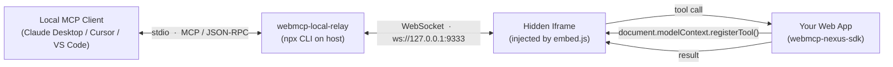

<div align="center">

# WebMCP Nexus

**面向 [WebMCP](https://webmcp.org) 标准的零侵入前端集成方案。**

让任何 React 应用在数分钟内成为 MCP 客户端可直接驱动的对象。

**简体中文** | [English](./README.en.md)

[](https://www.npmjs.com/package/webmcp-nexus-sdk)
[](https://www.npmjs.com/package/vite-plugin-webmcp-nexus)
[](https://www.npmjs.com/package/webpack-plugin-webmcp-nexus)
[](./LICENSE)
[](#项目状态)

[**🚀 在线体验 Demo →**](https://alibaba.github.io/webmcp-nexus/)

</div>

---

## 目录

- [项目简介](#项目简介)
- [为什么选择 WebMCP Nexus](#为什么选择-webmcp-nexus)
- [核心亮点](#核心亮点)
- [项目结构](#项目结构)
- [快速开始](#快速开始)
- [三级注册策略](#三级注册策略)
- [示例应用](#示例应用)
- [让本地 Agent 操作 Web 应用](#让本地-agent-操作-web-应用)
- [AI 编码 Skill](#ai-编码-skill)
- [浏览器兼容](#浏览器兼容)
- [工具名冲突策略](#工具名冲突策略)
- [TypeScript 类型支持范围](#typescript-类型支持范围)
- [技术栈](#技术栈)
- [开发脚本](#开发脚本)
- [项目状态](#项目状态)
- [参与贡献](#参与贡献)
- [许可证](#许可证)

## 项目简介

[WebMCP](https://webmcp.org) 是 W3C 浏览器标准提案（由 Google 与 Microsoft 联合推动），允许网页通过 `document.modelContext.registerTool()` 将自身能力暴露为 MCP（Model Context Protocol）客户端可调用的工具。**WebMCP Nexus** 是围绕该标准的一套生产可用的前端工程化方案：

- **运行时 SDK** —— 只导出 2 个 API（`registerGlobalTools` / `useWebMcpTools`），覆盖全局、路由、组件三种生命周期。
- **构建插件** —— Vite & Webpack 双适配；构建时静态分析 TypeScript 类型 + JSDoc，自动生成 JSON Schema，工具函数零标注、零包装。
- **Polyfill 集成** —— 高版本浏览器走原生 API；其他环境由 SDK 入口自动加载内置 polyfill，业务代码完全无感。
- **Agent Skill** —— 内置面向 Claude Code、Cursor 等编码 Agent 的 Skill 文档，把"为函数生成工具"变成一句话指令。

> 一句话：写一个普通的 TypeScript 函数，加一行 JSDoc，它就能被任意 MCP 客户端调用。

## 为什么选择 WebMCP Nexus

| 维度       | 业内常见做法                         | WebMCP Nexus                                                                                       |
| ---------- | ------------------------------------ | -------------------------------------------------------------------------------------------------- |
| API 表面   | 装饰器 / 包装函数 / 显式 schema 配置 | **2 个 API** 覆盖全部场景                                                                          |
| 类型契约   | 手写 JSON Schema 与 TS 类型双源维护  | 构建时基于 `ts-morph` **从 TS 类型反推**，单一事实源                                               |
| 函数侵入度 | `defineApi` / `createTool` 等包装    | **零侵入**——函数保持原样，原有调用方完全无感                                                       |
| 生命周期   | 仅全局注册，需手动管理               | 全局 / 路由 / 组件 **三级作用域**，组件卸载自动注销                                                |
| 浏览器兼容 | 调用方自行判断 + 兜底                | SDK 内置 polyfill **惰性加载**，Chrome / Firefox / Safari 全覆盖                                   |
| 桌面接入   | 自行实现 stdio / WebSocket 桥接      | 与 [`@mcp-b/webmcp-local-relay`](https://www.npmjs.com/package/@mcp-b/webmcp-local-relay) 即插即用 |

## 核心亮点

- 🪶 **极简 API** —— `registerGlobalTools` + `useWebMcpTools`，30 秒看懂、5 分钟接入。
- 🔬 **构建时类型反推** —— 基于 `ts-morph` 静态分析，函数签名 = JSON Schema，无运行时开销。
- 🔁 **HMR 友好** —— 开发阶段修改函数签名，工具 schema 自动重新注册，无需手动刷新。
- 🧩 **三级作用域** —— 组件级工具随 React 生命周期挂载 / 卸载，杜绝"幽灵工具"污染上下文。
- 🛡️ **冲突感知** —— 内部 scope ownership registry，多 scope 同名注册时只警告不中断，注销严格隔离。
- 🌐 **跨浏览器透明兼容** —— Chrome 149+ 走原生 `document.modelContext`（146–149 由 polyfill 做入口桥接）；其他环境自动启用 `@mcp-b/webmcp-polyfill@5.1.0`。
- 🤝 **桌面 Agent 直连** —— 通过 `@mcp-b/webmcp-local-relay`，Claude Desktop / Cursor / VS Code 等本地 MCP 客户端可直接驱动 Web 应用。
- 🧠 **AI 编码 Skill 内置** —— "为现有函数生成 WebMCP 工具"成为编码 Agent 的一句话指令。

## 项目结构

```
webmcp-nexus/
├── apps/
│   └── demo/                        # 最佳实践示例（Vite + Webpack 双构建）
├── packages/
│   ├── webmcp-core/                 # 构建时核心：TS 类型抽取 + JSON Schema 生成
│   ├── webmcp-sdk/                  # 运行时 SDK（2 个 API + Polyfill）
│   ├── vite-plugin-webmcp/          # Vite 插件
│   └── webpack-plugin-webmcp/       # Webpack 插件
└── skill/
    └── SKILL.md                     # 面向 AI 编码 Agent 的接入 Skill
```

发布到 npm 公网 registry 的包：

| 包                                                                                         | 用途                       |
| ------------------------------------------------------------------------------------------ | -------------------------- |
| [`webmcp-nexus-sdk`](https://www.npmjs.com/package/webmcp-nexus-sdk)                       | 运行时 SDK                 |
| [`webmcp-nexus-core`](https://www.npmjs.com/package/webmcp-nexus-core)                     | 类型抽取 + Schema 生成内核 |
| [`vite-plugin-webmcp-nexus`](https://www.npmjs.com/package/vite-plugin-webmcp-nexus)       | Vite 构建插件              |
| [`webpack-plugin-webmcp-nexus`](https://www.npmjs.com/package/webpack-plugin-webmcp-nexus) | Webpack 构建插件           |

## 快速开始

> 前置条件：Node.js 18+，推荐 pnpm。

### 1. 安装

```bash
pnpm add webmcp-nexus-sdk
pnpm add -D vite-plugin-webmcp-nexus     # 或 webpack-plugin-webmcp-nexus
```

### 2. 配置构建插件

**Vite**

```ts
// vite.config.ts
import { defineConfig } from 'vite';
import react from '@vitejs/plugin-react';
import { vitePluginWebMcp } from 'vite-plugin-webmcp-nexus';

export default defineConfig({
  plugins: [react(), vitePluginWebMcp({ include: ['src/**/*.ts', 'src/**/*.tsx'] })],
});
```

**Webpack**

```ts
// webpack.config.ts
import { WebMcpPlugin } from 'webpack-plugin-webmcp-nexus';
import type { Configuration } from 'webpack';

const config: Configuration = {
  // ... entry / module / resolve 等常规配置
  plugins: [new WebMcpPlugin({ include: ['src'] })],
};

export default config;
```

完整双构建示例参见 [apps/demo/vite.config.ts](apps/demo/vite.config.ts) 与 [apps/demo/webpack.config.ts](apps/demo/webpack.config.ts)。

### 3. 编写一个普通的 TS 函数

```ts
// src/tools/queries.ts
/**
 * 根据关键词搜索任务。
 * @readonly
 */
export async function searchTasks(params: {
  /** 搜索关键词 */
  query: string;
  /** 返回数量上限（默认 50） */
  limit?: number;
}): Promise<{ count: number; tasks: Task[] }> {
  // ... 你原本的业务实现，不需要任何包装
}
```

### 4. 注册

```ts
// src/main.tsx
import { registerGlobalTools } from 'webmcp-nexus-sdk';
import * as queries from './tools/queries';

registerGlobalTools(queries);
```

构建插件会自动从 `searchTasks` 的 TS 类型 + JSDoc 反推出 JSON Schema，并通过 `__webmcpSchema` 字段注入到函数对象上；SDK 在运行时读取该字段向 `document.modelContext` 完成注册。

## 三级注册策略

| 级别 | API                     | 生命周期               | 适用场景                     |
| ---- | ----------------------- | ---------------------- | ---------------------------- |
| 全局 | `registerGlobalTools()` | 应用启动注册，永不注销 | 通用 API（查询、认证、CRUD） |
| 路由 | `useWebMcpTools()`      | 页面 mount / unmount   | 当前路由独占的操作           |
| 组件 | `useWebMcpTools()`      | 组件 mount / unmount   | 弹窗、面板等局部交互         |

**路由 / 组件级注册示例：**

```tsx
import { useWebMcpTools } from 'webmcp-nexus-sdk';

export default function TasksPage() {
  const { createTask, updateTask, deleteTask } = useTodoStore();

  useWebMcpTools({ createTask, updateTask, deleteTask });

  return /* … */;
}
```

组件卸载时同名工具自动从 `modelContext` 注销，**避免 Agent 在错误的页面调用错误的工具**。

## 示例应用

仓库内 [`apps/demo`](apps/demo) 是一个完整的 Todo / 项目管理应用，演示了所有典型集成模式：全局查询工具、组件级表单工具、路由跳转工具、HMR 调试面板等。

> 🌐 **在线预览**：<https://alibaba.github.io/webmcp-nexus/> （由 GitHub Pages 自动部署，跟随 `main` 分支更新）

```bash
pnpm install
pnpm dev               # 启动 Vite demo（http://localhost:5173）
pnpm dev:webpack       # 启动 Webpack demo（http://localhost:3001）
```

打开应用后按 <kbd>⌘</kbd> + <kbd>\\</kbd> 唤起内置 **Debug Panel**，可实时查看已注册的工具、参数 schema 与调用结果。

关键代码索引：

- 全局工具注册入口：[apps/demo/src/main.tsx](apps/demo/src/main.tsx)
- 全局查询工具集：[apps/demo/src/tools/queries.ts](apps/demo/src/tools/queries.ts)
- 路由跳转工具：[apps/demo/src/tools/navigation.ts](apps/demo/src/tools/navigation.ts)
- 页面级工具注册：[apps/demo/src/pages/TasksPage.tsx](apps/demo/src/pages/TasksPage.tsx)

## 让本地 Agent 操作 Web 应用

借助官方 [`@mcp-b/webmcp-local-relay`](https://www.npmjs.com/package/@mcp-b/webmcp-local-relay)，Claude Desktop、Cursor、VS Code 等本地 MCP 客户端可以**直接调用浏览器中正在运行的 Web 应用**——你的应用就此成为 Agent 的"双手"。

### 工作原理



- `webmcp-local-relay` 在本机以 **stdio MCP server** 形式运行，由桌面 Agent 拉起；
- 同时它在 `localhost:9333` 暴露一个 WebSocket 端点；
- Web 应用通过加载 relay 提供的 `embed.js`，在页面注入一个隐藏 iframe，由该 iframe 与 relay 建立 WebSocket 连接，并把 `document.modelContext` 上注册的全部工具实时上报给桌面 Agent。

### 接入步骤

> **前置要求**：relay CLI 的 `engines` 是 **Node 22+**（`npx -y @mcp-b/webmcp-local-relay@5` 在 Node 20 下会直接失败）；页面侧需 `@mcp-b/webmcp-polyfill` 5.x（本 SDK 已内置）或原生 Chrome 149+。

**1. 在页面中引入 `@mcp-b/webmcp-local-relay` 的 `embed.js`**

在 Web 应用的入口 HTML（如 [apps/demo/index.html](apps/demo/index.html)）追加一行：

```html
<!-- index.html -->
<script src="https://cdn.jsdelivr.net/npm/@mcp-b/webmcp-local-relay@5/dist/browser/embed.js"></script>
```

该脚本会注入一个隐藏的 blob iframe，读 `document.modelContext`，通过 `getTools()` 发现工具、`executeTool()` 调用工具（每次调用前重新拉取 descriptor，避免陈旧对象），并建立到本机 relay 的 WebSocket 通道。**业务代码与 SDK 调用方式完全无需改动**。

三条硬约束：

- **钉到 `@5` 而非 `@latest`**：上游主版本升级可能再次静默 breaking（relay 5.x 就只认 `document.modelContext`，而 2.x 只认 `navigator.modelContext`）。
- **必须是经典同步 `<script>`**：`embed.js` 靠 `document.currentScript` 读 `data-*` 属性，加 `type="module"` / `defer` / `async` 会让**全部属性静默回落默认值**。
- **自托管时必须同时提供同目录的 `widget.html`**：`embed.js` 会 `fetch` 它并构造 blob iframe，**fetch 失败则 relay fails closed**（只有一条 `console.error`，工具完全不上报）。跨源托管需允许 CORS。若使用国内镜像，请镜像整个 `dist/browser/` 目录而非单个文件。

完整的 `data-*` 属性（`embed.js` 5.1.0）：

| 属性                   | 默认值      | 用途                                                                                                      |
| ---------------------- | ----------- | --------------------------------------------------------------------------------------------------------- |
| `data-relay-host`      | `127.0.0.1` | relay 监听地址                                                                                            |
| `data-relay-port`      | `9333`      | 首选端口。实际会在 **9333–9348** 范围内探测，选中结果持久化到 `~/.webmcp/relay-port.json`                 |
| `data-request-timeout` | `60000`     | 单次工具调用超时（ms）。需与 CLI 的 `--invoke-timeout`（默认 65000）**配对**调整，页面值更高时 CLI 要略大 |
| `data-relay-id`        | —           | 多 relay 共存时按 ID 过滤                                                                                 |
| `data-relay-workspace` | —           | 多 relay 共存时按工作区过滤                                                                               |
| `data-auto-connect`    | `true`      | 设 `"false"` 可延迟发现，直到收到 `webmcp.connect` 消息                                                   |
| `data-debug`           | 关闭        | 开启 `[webmcp-relay-embed]` 诊断日志。**排查时必开**                                                      |

> **CSP 要求**：`frame-src blob:`、`script-src blob:`（blob iframe 内联了配置 script）、`connect-src ws://127.0.0.1:9333-9348`。限制性 CSP 的站点会静默失败。

**2. 在 MCP 客户端中安装 relay**

**首选：MCPB 一键安装**。从 [GitHub Releases](https://github.com/WebMCP-org/npm-packages/releases) 下载 `.mcpb` 文件双击安装，零配置、无需终端，默认就是 loopback + 自动端口发现 + 允许全部页面 origin。

**次选：JSON 配置**。以 Claude Desktop 为例，编辑 `claude_desktop_config.json`：

```json
{
  "mcpServers": {
    "webmcp-local-relay": {
      "command": "npx",
      "args": ["-y", "@mcp-b/webmcp-local-relay@5"]
    }
  }
}
```

Cursor、VS Code 的 MCP 配置方式相同，差异仅在配置文件位置。也可以直接跑 CLI：`npx @mcp-b/webmcp-local-relay`。

**3. 启动 Web 应用并在 Agent 端驱动**

```bash
pnpm dev      # 任何接入了 webmcp-nexus-sdk 的应用即可
```

重启 Claude Desktop / Cursor，新会话中即可看到来自浏览器的工具。例如对 demo 应用说：

> "把所有 todo 状态的任务按截止日期升序展示，然后把第一条标记为已完成。"

Agent 会依次调用 `listTasks` → `setTaskSort` → `setTaskStatus`，并在浏览器中可视化地完成全部操作。

### 在 MCP 客户端里会看到什么

**3 个静态管理工具**（relay 自带，与你的工具并列）：

| 工具                  | 用途                                                   |
| --------------------- | ------------------------------------------------------ |
| `webmcp_list_sources` | 列出已连接的浏览器标签页及其元数据                     |
| `webmcp_list_tools`   | 列出全部被转发的工具及其来源。**排查时先调它**         |
| `webmcp_open_page`    | 打开 URL，或在 server 模式下按 origin 刷新已连接的页面 |

**工具名会被 relay 改写**，这不是 bug：

- `sanitizeName` 把 `[^a-zA-Z0-9_]` 全部替换为 `_`。WebMCP 协议允许工具名含 `.` 与 `-`，但 MCP 客户端看到的会是 `get_canvas_info` 而非 `get-canvas-info`。**因此工具名请只用 camelCase**（见 [`skill/SKILL.md`](skill/SKILL.md)）。
- 多个标签页发布同名工具时，全部追加 `_<4 位 tabId>` 后缀（如 `search_ed93`、`search_a1b2`），冲突再追加 `_2`/`_3`。**关掉多余的标签页即可消除后缀**。
- 名称截断到 128 字符。

排错请优先参考 [relay 的 Troubleshooting 表](https://www.npmjs.com/package/@mcp-b/webmcp-local-relay#troubleshooting)（不在此复制，避免上游更新后两边漂移）。nexus 特有的一条：若 MCP 客户端看不到工具，先打开 demo 的 DebugPanel（`Cmd/Ctrl + \`）确认工具已在页面内注册，再给 `embed.js` 加 `data-debug` 看 `[webmcp-relay-embed]` 日志。

## AI 编码 Skill

仓库 [`skill/SKILL.md`](skill/SKILL.md) 是一份为 AI 编码 Agent 量身打造的 Skill 文档，覆盖：

- 工具函数签名、JSDoc、TS 类型的硬性约束（MUST / SHOULD / MAY 三级）；
- **零风险改造流程**：把现有业务函数改造为 WebMCP 工具时，只动签名与注释，不动业务逻辑；
- SDK 与 Vite / Webpack 构建插件的接入引导；
- 真实场景的正反对照示例。

### 安装

<details>
<summary><strong>Claude Code</strong></summary>

```bash
# 项目级（仅当前仓库生效）
mkdir -p .claude/skills
cp skill/SKILL.md .claude/skills/webmcp-nexus.md

# 用户级（所有项目生效）
mkdir -p ~/.claude/skills
cp skill/SKILL.md ~/.claude/skills/webmcp-nexus.md
```

</details>

<details>
<summary><strong>Cursor</strong></summary>

```bash
mkdir -p .cursor/rules
cp skill/SKILL.md .cursor/rules/webmcp-nexus.mdc
```

或在 Settings → Rules 中粘贴 `skill/SKILL.md` 的全部内容。

</details>

<details>
<summary><strong>其他 AI IDE（Qoder / Windsurf 等）</strong></summary>

将 `skill/SKILL.md` 作为 Rule / Context 文档导入到 IDE 的 AI 配置中即可。所有触发词均已写入 frontmatter 的 `description` 字段，主流 Agent 框架可自动按需加载。

</details>

### 使用示例

> "把 `apps/demo/src/store/TodoStore.tsx` 里的 `createTask` 改造成 WebMCP 工具，注册到任务列表页。"

Agent 会按 Skill 中规定的流程，自动补齐 JSDoc、调整参数为对象形态、在对应组件挂载点调用 `useWebMcpTools`，且**不修改任何业务逻辑**。

## 浏览器兼容

WebMCP 草案在 2026-05-27 把 `modelContext` getter 从 `Navigator` 移到 `Document`（[webmcp#173](https://github.com/webmachinelearning/webmcp/issues/173) / [#184](https://github.com/webmachinelearning/webmcp/pull/184)），Chrome 150 已废弃 `navigator.modelContext`。SDK 全链路 **document 优先、navigator 兜底**，业务代码无感。

| 环境                                         | 行为                                                                                                                                                                                                                                                                                                   |
| -------------------------------------------- | ------------------------------------------------------------------------------------------------------------------------------------------------------------------------------------------------------------------------------------------------------------------------------------------------------ |
| Chrome 150+（Origin Trial / flag）           | 原生 `document.modelContext` 为规范入口；`navigator.modelContext` 为已废弃别名（首次访问有一次性 warning）。**nexus 不改写宿主对象**                                                                                                                                                                   |
| Chrome 149                                   | Origin Trial 起始版；仍是 `navigator.modelContext`，`@mcp-b/webmcp-polyfill@5.1.0` 自动做**入口桥接**（同一实例搬到 document 上，不替换、不包装原生实现）                                                                                                                                              |
| Chrome 146–148                               | flag-only。146–147 有 `unregisterTool`（nexus 走 L2 注销兜底），148 起移除改用 `AbortSignal`。nexus 在这一档保留全套兼容层（补齐 EventTarget、合成 `listTools`/`callTool`、桥接 `toolchange`），并**额外从 `modelContextTesting` 合成 `getTools`/`executeTool`**，使 relay 5.x 在该档也可发现/调用工具 |
| Chrome <146 / Firefox / Safari / Edge legacy | 首次注册时自动安装 [`@mcp-b/webmcp-polyfill@5.1.0`](https://www.npmjs.com/package/@mcp-b/webmcp-polyfill)；`document.modelContext` 为规范入口，对业务透明                                                                                                                                              |

> **relay 5.x 全档可用**：polyfill 自持档与 Chrome 149+ 原生自带 `getTools`/`executeTool`；Chrome 146–148 由 nexus 从 `modelContextTesting` 合成（若该档浏览器不带 `modelContextTesting`，则 relay 调用会拿到 `NotSupportedError`，页面内注册/调用仍可用）。relay 2.x 仍可在 polyfill 自持档与 146–148 档使用，但新接入请直接用 relay 5.x。

> **`inputSchema` 的形态不按浏览器版本分档**。polyfill 5.x 自持 context 时返回 JSON Schema **对象**；而 Chrome 149 起的 **same-document 工具仍返回序列化字符串**（[webmcp#241](https://github.com/webmachinelearning/webmcp/issues/241) 的对象化自 Chrome 154.0.8013 起 cross-document 先行滚动发布，边界还在上移），而 nexus 注册的全是 same-document 工具。因此 SDK 对 **string / object / 缺键** 三种形态全部兼容，一律特征检测、不做版本嗅探。

### 宿主准入要求

polyfill 5.x 与原生 Chrome 都会在 `registerTool` / `getTools` / `executeTool` 入口跑一整套准入校验（2.x 不校验）。不满足时工具会**注册失败**，SDK 按 `error.name` 给出可诊断提示：

| 前置条件                                                                                                   | 不满足时                                               |
| ---------------------------------------------------------------------------------------------------------- | ------------------------------------------------------ |
| 必须是 secure context                                                                                      | polyfill 直接不安装                                    |
| 必须是 **origin-isolated** 文档：`Origin-Agent-Cluster: ?0` 或启用 `document.domain` 会禁用全部 WebMCP API | `SecurityError`                                        |
| Permissions Policy `tools`（默认 `self`）：跨源 iframe 必须加 `allow="tools"`                              | `NotAllowedError`                                      |
| 文档必须 fully active（导航中的注册会被忽略）                                                              | `InvalidStateError`（静默）                            |
| 工具名匹配 `^[A-Za-z0-9_.-]{1,128}$`、`description` 非空                                                   | `InvalidStateError`。SDK 与构建插件均已兜底 / 校验左移 |
| 跨文档暴露（`exposedTo` / `fromOrigins`）需原生 WebMCP                                                     | `NotSupportedError`（polyfill 不支持）                 |

注册失败**不会阻断 UI 渲染**，失败的工具也不会出现在 widget 推送里（幽灵工具防护）。

## 1.0.0 迁移说明

完整变更见 [CHANGELOG.md](./CHANGELOG.md)。要点：

- **SDK 对外 API 只增不改**：`registerGlobalTools` / `useWebMcpTools` / `withWebMcpTools` 的签名与行为保持不变，业务代码与构建插件配置均无需改动。
- 宿主面从 `navigator.modelContext` 迁到 `document.modelContext`（SDK 内部已完成，无感）。
- `unregisterTool` 已从协议移除 → 注销统一走 `registerTool(tool, { signal })` 的 `AbortSignal`（SDK 内部已完成）。
- `registerTool` 现为异步且失败不阻断 UI。
- **工具函数可以声明第二个参数拿执行取消信号**：`async (params, { signal }) => {...}`。现有单参工具零改动。
- **新增三个 JSDoc 标签**：`@title <文本>`、`@untrusted`、`@consequential`，与既有的 `@readonly` 同构。`__webmcpSchema` 从三字段扩为六字段。
- **构建期新增校验**：工具名不合法时 `pnpm build` 直接报错（而非静默产出不可注册的工具）。
- relay 的 `embed.js` 需升到 **5.x**（见上方接入步骤）。

## 与 `@mcp-b/` 其他包的关系

- **`@mcp-b/global` 不可与本 SDK 同时引入**。它 import 即自动初始化，用 value 描述符把 `document` / `navigator` 两个面**替换**为 `BrowserMcpServer`，会摧毁 nexus 在旧宿主档的兼容层。两者二选一。
- **`@mcp-b/webmcp-local-relay` 5.x** 只读 `document.modelContext`、只认 `getTools()` + `executeTool()`。**relay 2.x 仅在 polyfill 自持 context 的浏览器（Chrome <146 / Firefox / Safari）下可用** —— 因为 `installTestingShim` 提供的 `navigator.modelContextTesting` 只在 polyfill 自持 context 时安装，原生 Chrome 下 polyfill 会提前 return。Chrome 149+ 请升到 relay 5.x。relay 的「Runtime Compatibility」列了三种受支持运行时（`@mcp-b/global` / 原生 Chrome / `@mcp-b/webmcp-polyfill`），**nexus 属第 3 条覆盖**。
- **`usewebmcp` / `react-webmcp` / `webmcp-ts-sdk`** 是上游的同类方案，与 nexus 定位不同：nexus 的差异化价值是**构建时从 TS 类型 + JSDoc 反推 schema**、**三级作用域**与 **scope ownership registry**，这三者上游都没有。nexus 不依赖它们。
- **declarative forms**：polyfill 5.1.0 会自动安装声明式表单支持（`<form toolname tooldescription toolautosubmit toolparamdescription>`、`SubmitEvent.agentInvoked` / `respondWith()`）。这类工具由 polyfill 直接注册进宿主，**不经 nexus 的所有权镜像**，因此会出现在 `document.modelContext.getTools()` 与 demo 的 DebugPanel 中，但不出现在 nexus 的 widget 推送里。`window` 上的 `toolactivated` / `toolcancel` 事件与 CSS `:tool-form-active` / `:tool-submit-active` 伪类**仅原生 Chrome 支持**，polyfill 不模拟。
- polyfill 5.1.0 为支持 declarative forms 会改写 `Element.prototype.attachShadow` 与 `HTMLFormElement.prototype.submit`。使用 shadow DOM 或自定义表单提交逻辑的项目需评估。
- **`@mcp-b/webmcp-types@5.1.0`** 作为类型依赖引入（`import type`，不进浏览器产物），提供 `Document.modelContext` / `Navigator.modelContext` / `SubmitEvent.agentInvoked` 的全局声明（5.1.0 已全部改为可选）。

## 工具名冲突策略

SDK 内部维护 scope ownership registry，记录每个工具名的注册来源（scope + scopeId）：

- 多个 scope 注册同名工具时：控制台输出警告，**但仍允许注册**，不阻断 UI 渲染；
- 注销时只清理自己 scope 的注册，不影响其他作用域的同名工具。

> **最佳实践**：使用语义化的唯一工具名，不同层级避免同名冲突。

## TypeScript 类型支持范围

**已稳定支持**

- 基础类型（`string` / `number` / `boolean`）
- 字面量联合（`'a' | 'b' | 'c'` → `enum`）
- 可选属性（`prop?` → 不进入 `required`）
- 嵌套对象（≤ 3 层）

**不建议依赖**

- 泛型（`Record`、`Partial`、`Pick` 等）
- 映射类型 / 条件类型
- 超过 3 层的深度嵌套；对象数组中的对象元素 schema

## 技术栈

- React 19 + TypeScript + Vite 8 / Webpack 5
- pnpm workspace monorepo
- `ts-morph` 驱动的构建时类型抽取
- Vitest 测试框架

## 开发脚本

```bash
pnpm install          # 安装依赖
pnpm dev              # 启动 Vite demo
pnpm dev:webpack      # 启动 Webpack demo
pnpm build            # 构建所有包
pnpm test             # 运行全部包的测试
pnpm lint             # ESLint
pnpm format           # Prettier
pnpm changelog        # 从 git log 生成/更新根 CHANGELOG.md
pnpm changelog:preview # 只预览不写入
VERSION=major pnpm release  # 升版 + 生成 CHANGELOG + 构建 + 发布（DRY_RUN=1 可预检）
```

## 项目状态

WebMCP Nexus 的核心 API（`registerGlobalTools` / `useWebMcpTools`）与构建插件已在生产应用中稳定运行。底层 WebMCP 标准本身仍在 W3C 推进中，建议同步关注上游进展：

- WebMCP 标准：[webmcp.org](https://webmcp.org) ・ [W3C WebML CG 草案](https://webmachinelearning.github.io/webmcp/) ・ [Chrome 官方文档](https://developer.chrome.com/docs/ai/webmcp)
- 上游运行时 / Polyfill：[`@mcp-b/webmcp-polyfill@5.1.0`](https://www.npmjs.com/package/@mcp-b/webmcp-polyfill) ・ [`@mcp-b/webmcp-types@5.1.0`](https://www.npmjs.com/package/@mcp-b/webmcp-types)
- 本机 Agent 桥接：[`@mcp-b/webmcp-local-relay@5.1.0`](https://www.npmjs.com/package/@mcp-b/webmcp-local-relay)
- 本仓变更记录：[CHANGELOG.md](./CHANGELOG.md)

## 参与贡献

欢迎通过 Issue 与 Pull Request 参与项目：

- 🐛 **Bug Reports** —— 请尽量附带最小复现仓库；
- 💡 **Feature Requests** —— 优先讨论使用场景，再讨论 API；
- 🛠️ **Pull Requests** —— 提交前请运行 `pnpm lint && pnpm test`，并保持每个 commit 聚焦单一变更。

提交 PR 即视为同意以 [MIT License](./LICENSE) 授权你的贡献。

## 许可证

[MIT](./LICENSE)
